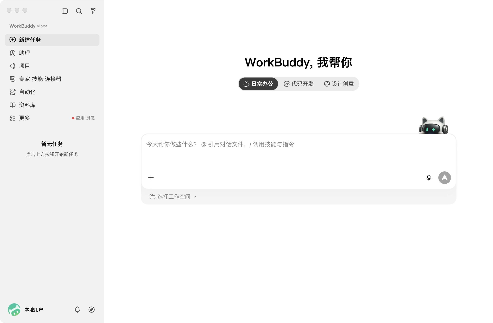
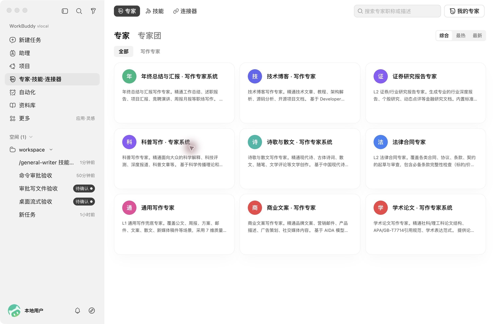
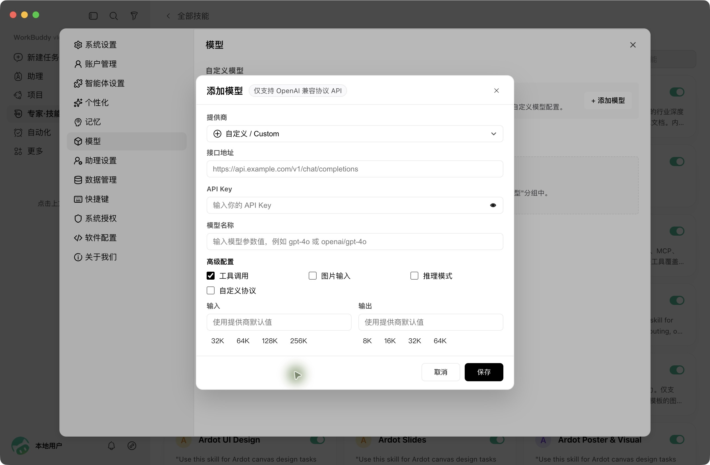
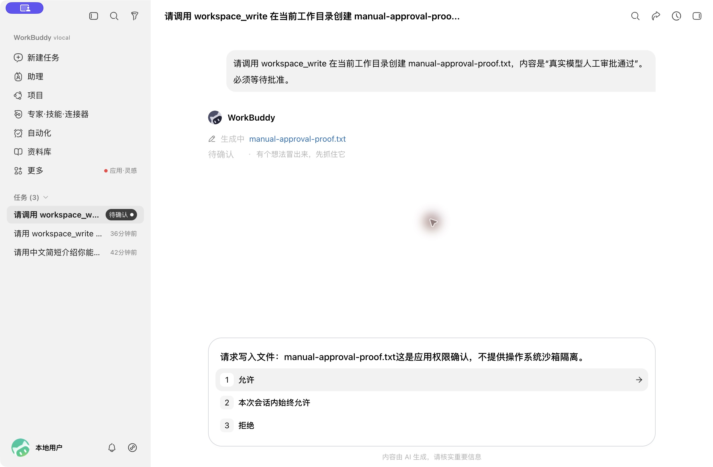

# WorkBuddy Local · WorkBuddy 逆向产品

### 从 WorkBuddy 逆向研究，到可运行的本地 Agent 工作台。

**这是一个基于 WorkBuddy 客户端逆向分析与交互复刻构建的产品项目。我们研究它的界面、桌面通信和业务流程，独立实现本地宿主与后端，再接入自选模型和 DSH 运行时，让复刻出来的产品能够实际工作。**



*本机复刻版实拍：WorkBuddy 标题、左侧导航、新建任务、场景切换和消息输入区。基于 5.3.14 界面资源展示；公开源码默认网页 UI 与此不同。*

模型的能力，需要经过产品才能成为日常工作的能力。一次任务里，用户需要选择资料、调用工具、决定是否允许修改文件；任务中断后，还需要找到记录、恢复上下文、继续执行。这些看似琐碎的环节，决定了一个 Agent 能否被实际使用。

WorkBuddy Local 就围绕这些环节构建。项目从 WorkBuddy 的客户端行为与交互研究出发，独立实现本地业务服务、Electron 宿主和兼容适配层，并接入 DSH 运行时。公开源码提供独立编写的网页界面，供你运行、研究，也供你继续构建自己的 Agent 产品。

[快速运行](#快速启动) · [产品能力](#从请求到交付工作如何发生) · [架构](#产品层与运行时各司其职) · [当前进度](#当前进度与边界)

## 逆向了什么，重新实现了什么

项目以 WorkBuddy 5.3.14 为最初研究基线，保留旧版成果，再核对 5.8.3 的差异。研究覆盖客户端资源结构、renderer 与桌面宿主的通信契约，以及会话、设置、专家、技能和工具审批等产品流程。

在此基础上，独立实现 Electron 宿主、IPC 兼容桥、本地业务服务、持久化与工具审批，并接通真实模型。执行层通过 DSH 适配复用已有框架。重点是把逆向得到的产品结构转化为可运行、可验证的功能。

这不是腾讯官方源码泄露，也不是完整恢复了官方后台。下面展示本机复刻版的实际界面；公开仓库提供独立实现源码与网页 UI，不打包分发原版界面资源。

## 本机复刻版截图

以下为开发过程中的真实验收截图，展示复刻版的产品形态。截图基于本机使用的 5.3.14 界面资源；公开源码默认启动的独立网页 UI 与此不同。截图不代表全部原版功能或 5.8.3 适配已完成。

### 专家、技能与连接器入口



还原桌面产品的专家入口与目录展示。截图里的内置目录用于界面研究展示，不随公开源码分发；自定义专家与技能管理由本地服务独立实现。

### 设置与模型配置



复刻设置中的模型配置流程，对接自选 OpenAI 兼容接口。截图中的密钥字段为空，不包含真实密钥。

### 真实工具调用与写入审批



真实模型发起文件写入，界面展示生成中的文件、侧栏待确认状态与审批卡片。该截图记录的是等待人工批准的时刻；审批由独立实现的本地产品服务处理。

## 为什么值得打开这个项目

- **模型由你选择。** 支持 OpenAI 兼容接口，可以连接本机模型服务，也可以连接你配置的远程服务。
- **围绕真实工作区执行。** 浏览、读取和编辑文件，生成基础 Office 文档，预览本地静态站点；文件写入与命令执行进入审批流程。
- **把工作方法留下来。** 自定义专家、技能与记忆，让角色指令和重复使用的方法成为可管理的产品内容。
- **让任务能够延续。** 会话与工具记录持久化；可选 DSH 路径已验证会话恢复与取消，不必让所有状态都依赖一个始终打开的窗口。
- **把产品如何工作摊开。** 从界面、桌面桥接、业务接口到 DSH 工具适配都能查看源码，适合研究 Agent 产品，也适合开发自己的本地工作台。

## 从请求到交付，工作如何发生

例如，让 Agent 根据工作区里的资料整理一份文档：

1. 在设置中配置模型，选择工作目录，开始一个会话。
2. 按任务选择专家或技能，允许模型调用当前开放的读取、搜索与文档工具。
3. 当任务需要写文件或执行命令时，查看请求并批准或拒绝。
4. 在工作区检查产物，在会话中查看过程，继续追问或取消当前任务。

图片与 WAV/MP3 也已接入输入链路；使用本地视觉和语音转写时，需要单独准备相应依赖与模型。

## 产品层与运行时，各司其职

项目把用户操作、业务状态和 Agent 执行衔接起来：

```text
独立网页界面 / Electron 桌面宿主
                 │
       会话、设置、专家、技能、审批
                 │
         本地业务服务与工具层
                 │
       可选 DSH profile / SDK 适配
                 │
       你配置的模型与实际工具执行
```

DSH 接入复用已有运行时，通过命名 profile 和外部适配插件连接产品。工具调用仍经过产品侧的权限与审批逻辑；DSH 核心无需修改。新会话可启用 DSH，已有旧引擎会话继续保留。

| 层次 | 你可以研究或复用的内容 |
| --- | --- |
| 产品交互 | 流式对话、取消、工作区、设置和审批状态 |
| 工作方法 | 自定义专家、技能、记忆及其管理流程 |
| 工具与连接 | 文件与命令、MCP、Office 基础读写、本地预览、自动化 |
| 桌面宿主 | Electron 生命周期、IPC 兼容桥、本地模型管理和输入适配 |
| 运行时适配 | DSH 会话、恢复、取消与审批工具桥接 |

## 当前进度与边界

这是 **0.1.0 开发预览版**。公开源码版测试结果为 **249 项通过、0 项失败、9 项跳过**；另在本机完成过真实 Qwen 模型、DSH 对话、审批写文件及技能创建/调用验收。跳过项与验证范围见 [发布说明](docs/PUBLISHING.md)。

专家团执行、完整专家流程的 DSH 验收、WorkBuddy 5.8.3 全量适配及跨平台打包仍待完成。腾讯账号、微信绑定和官方云市场未接入。

本项目为独立实现，与腾讯无隶属或背书关系。公开版默认使用独立网页 UI；原版 renderer、字体、图标、内置专家与技能、安装包及反编译产物均不随仓库分发，不能将此仓库理解为原版客户端的完整开源副本。

## 快速启动

需要 Node.js 24.11+ 和 Python 3。

```bash
git clone https://github.com/Allen1anz/workbuddy-local.git
cd workbuddy-local
npm ci
npm start
```

打开 http://127.0.0.1:18721，在设置中填写模型 API 根地址、模型名称和密钥，再选择工作目录。本机 OpenAI 兼容服务也可使用，模型权重需要自行准备。

## DSH 接入

单独准备并构建兼容的 DSH 仓库（本次本地验证版本为 0.2.0-rc.2），确保存在 `apps/cli/lib/bin.js` 和 `packages/sdk/client/lib/index.js`。在应用数据目录创建 `dsh-runtime.json`：

```json
{"enabled":true,"repository":"/absolute/path/to/dsh"}
```

网页数据目录默认为 `.data`；桌面默认在 `~/Library/Application Support/WorkBuddy Local/data`。新会话使用 DSH；已有旧引擎会话继续保留。适配器通过 `sdk-minimal` 命名 profile 启动，不修改 DSH 核心。

## 桌面开发

```bash
npm install --no-save --package-lock=false electron@37.10.3
npm run desktop
```

桌面默认使用公开网页界面。兼容桥和旧 renderer 专用的独立设置窗口需要另行提供有权使用的资源；仓库不提供这些资源，也不提供包含它们的二进制下载。`desktop/build.mjs` 是 macOS 本地打包工具，需要按源码中的目录安装 Electron runtime，未作为跨平台发布流程验收。

## 测试与发布

```bash
npm test
# 可选：使用本机已构建 DSH 运行真实 runtime 协议测试
DSH_REPOSITORY=/absolute/path/to/dsh npm test
```

发布版测试结果和外部资源测试范围见 [发布说明](docs/PUBLISHING.md)。测试中的脚本模型仅用于协议验证；本机此前另做过真实 Qwen 模型验收。

模型接口会收到对话和工具读取的内容。密钥存于本机数据目录，未做数据库加密。获批 shell 使用当前用户权限，工作目录不是操作系统沙箱。应用默认仅监听回环地址。

## 许可证

本仓库独立实现代码采用 [MIT](LICENSE)。第三方依赖、模型和用户自行提供的资源分别受各自许可证约束；MIT 不授予 WorkBuddy 商标、原版代码或素材的权利。见 [第三方说明](THIRD_PARTY_NOTICES.md)。
